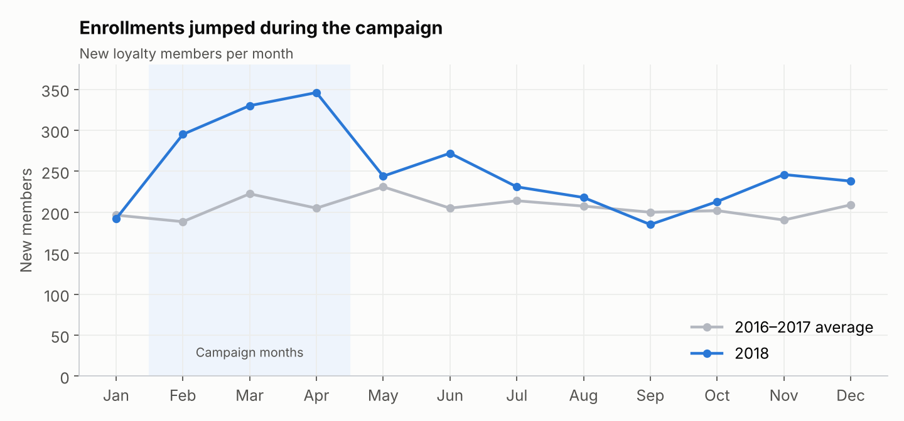
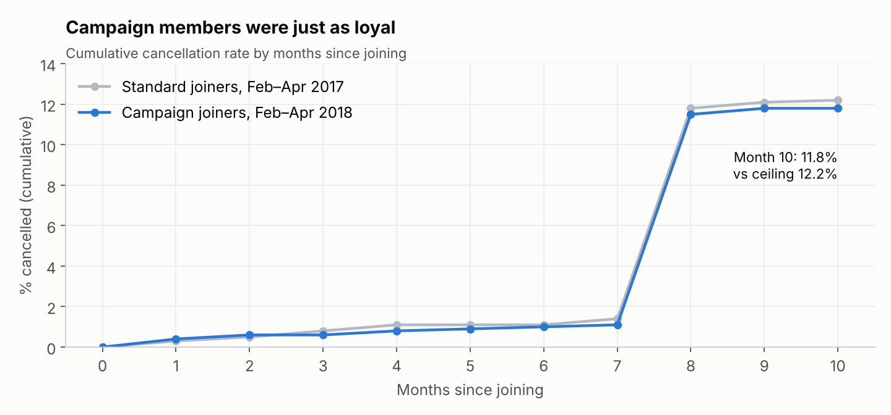
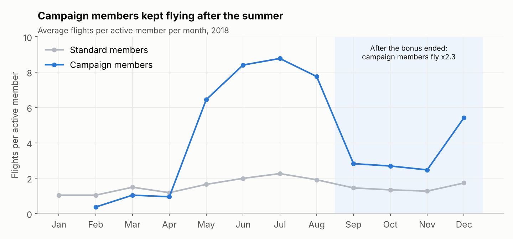
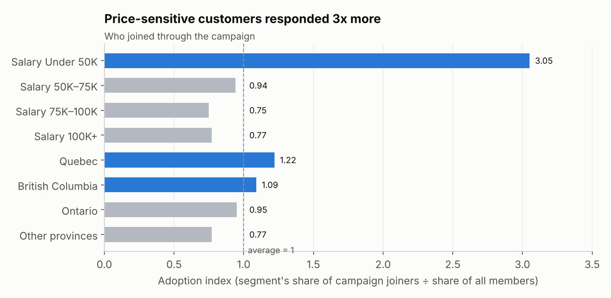

# Did the Loyalty Campaign Work? — Airline Loyalty Program Analysis

**Python · SQL (DuckDB) · KPI design · Cohort retention · Segmentation · Forecasting · Dashboard**

> A Canadian airline ran a 3-month promotion to grow its loyalty program. Our team defined how to measure success, built the KPIs in Python and SQL, and turned the results into a go / no-go recommendation for management and a targeting plan for marketing.



---

## TL;DR

| | |
|---|---|
| **Business question** | Northern Lights Air gave new loyalty members +50% points in Feb–Apr 2018. Did it work, and should they repeat it? |
| **Answer** | **Yes — 3 of 3 KPIs met.** The campaign drove **36% of the program's 2018 net growth**, brought in members who were **as loyal** as regular joiners, and who flew **2.3x more** even after the bonus ended. |
| **Recommendation** | Repeat in Feb–Apr 2019 (forecast: ~703 joiners without a campaign vs ~1,007 with one), target price-sensitive customers, and add a September retention step. |

---

## 1. Data

| Table | Rows | Content |
|---|---|---|
| `Customer_Loyalty_History.csv` | 16,737 members | Demographics, salary, card tier, enrollment type (`Standard` / `2018 Promotion`), enrollment & cancellation dates (2012–2018) |
| `Customer_Flight_Activity.csv` | 392,936 rows | Per member per month (2017–2018): flights, distance, points earned and redeemed |

Source: the *Airline Loyalty Program* dataset (Maven Analytics), provided as part of the Hebrew University Data & AI Analyst Program. The company is fictional.

## 2. Data cleaning — what we fixed and why

| Issue | Scope | Decision |
|---|---|---|
| Fully duplicated activity rows | 1,922 rows | Dropped — they would inflate every count |
| Several different rows for the same member-month | 135 members | Summed into one row per member-month |
| Negative salary | 20 members | Absolute value (sign typo) |
| Missing salary | 4,238 members (25%) | **Left missing** — it is systematic (all `College` members), so mean-imputation would bias the data |
| Empty cancellation date | 14,670 members | Means *still active*, not missing |
| Flights recorded before enrollment | ~3,200 rows | Flagged for review |

**Key definition — "active member in a month":** joined by that month and did not cancel before it. All per-member metrics are calculated only over active months (including months with zero flights).

## 3. Choosing the right KPIs

The obvious numbers were misleading, so we rejected them first:

- **Total points earned** — inflated by the 50% bonus itself, not by more flying.
- **"+44% summer flights"** — mostly because there were more members, not more active ones.
- **Demographics / CLV** — describe customers, but don't judge success.

Every KPI we kept follows three rules: **a fair baseline** (same months last year, or a matched cohort), **normalized per member**, and **a clear pass/fail threshold**. The case set no targets, so all targets were derived from historical data — not from the results.

## 4. Results — 3 of 3 SMART KPIs met

| KPI | Metric | How the target was set | Target | Actual | |
|---|---|---|---|---|---|
| **1 · Acquisition** | New members, Feb–Apr 2018 | +25% over Feb–Apr 2017 (629) — several times the historical 0–6% growth | ≥ 786 | **971** | ✅ +24% above target |
| **2 · Retention** | % cancelled within 10 months | **Ceiling:** the rate of regular members who joined Feb–Apr 2017 | ≤ 12.2% | **11.8%** | ✅ |
| **3 · Engagement** | Flights per active member / month, Jun–Aug | +10% over summer 2017 (2.06) | ≥ 2.26 | **2.48** | ✅ |



The cancellation jump at month 8 appears in **both** cohorts — it is a program-wide pattern, not a campaign effect. Comparing against a cohort that joined in the same months a year earlier gives both groups the same time to cancel; a naive comparison against all regular members would wrongly make the campaign look worse.

## 5. Insights

**1. Three months of campaign, a third of the year's growth.** The campaign brought 32% of all 2018 joiners and **36% of net member growth**, while being only 5.8% of the active base.

**2. They are active travellers, not just names on a list.** The summer spike is expected (that is when the bonus pays). The real test is Sep–Dec, after the bonus ended: campaign members still flew **2.3x more** than regular members.



**3. Price-sensitive customers responded the most.** Members earning under 50K joined through the campaign at **3x** their share of the program. Quebec (1.22) and British Columbia (1.09) also over-indexed. Gender, marital status and card tier showed no meaningful difference.



**Room to improve:** 9.4% of campaign members stopped flying entirely after the summer. Members who flew 0 or 1–4 times in Sep–Dec cancelled at **23–29%**, versus **8.9%** for those who kept flying.

## 6. Forecast for 2019

Seasonal factor per month (2016–2017) × yearly level on a linear trend (2016–2018, campaign months excluded):

- **Feb–Apr 2019 without a campaign:** ~703 joiners
- **With a similar campaign** (2018 added ~43% over the expected level): ~1,007 joiners
- **Proposed 2019 target:** ≥ 879 joiners (+25% over the no-campaign forecast)

*Caveat: a repeat campaign may perform less well, since some interested customers have already joined.*

## 7. Recommendations

**For management**
1. Approve a repeat campaign for Feb–Apr 2019.
2. Adopt the three KPIs as official targets and track them monthly during the campaign, not only at the end.
3. Request cost-per-point and revenue-per-flight data from Finance, to add a profitability KPI.

**For marketing**
1. Focus on price-sensitive customers (adoption index 3.05).
2. Increase exposure in Quebec and British Columbia.
3. Add a September retention step (e.g. an autumn flight offer) for members who stop flying after the summer.

**Limitations:** no cost or revenue data, so profitability was not tested; data ends in Dec 2018; targets were set retrospectively from historical data.

---

## Repository structure

```
├── data/                     raw CSVs
├── notebooks/
│   └── loyalty_campaign_analysis.ipynb   full analysis with outputs (Python / pandas)
├── src/analysis.py           same analysis as a script (also generates the charts)
├── sql/
│   ├── 01_cleaning.sql       data-quality checks + clean tables
│   ├── 02_kpis.sql           the 3 KPIs, incl. a cohort retention curve
│   ├── 03_insights.sql       growth share, post-bonus behaviour, segmentation
│   └── run_sql.py            runs the SQL with DuckDB
├── dashboard/dashboard_hebrew.html  interactive dashboard as presented (Hebrew), opens in any browser
└── images/                   charts used in this README
```

The KPIs are implemented twice, in **pandas** and in **SQL**, and the results match exactly.

**Run it**
```bash
pip install -r requirements.txt
python src/analysis.py      # Python analysis + charts
python sql/run_sql.py       # same KPIs in SQL (DuckDB)
```

## Project context

Final team project in the Hebrew University Data & AI Analyst Program (Oct 2026). Team: Eden Gur-Arie, Avital Tripsik, Netanel Zarzavsky; mentor: Tal Mizrahi. Deliverables: EDA, KPI definition, dashboard, and a 12-minute presentation to the mentor.

**My role:** I led most of the analysis — data cleaning, KPI design and targets, the deep-dive analyses, the dashboard and the presentation. I used AI tools (Claude) as a coding and review partner throughout, most heavily for the 2019 forecast model.
